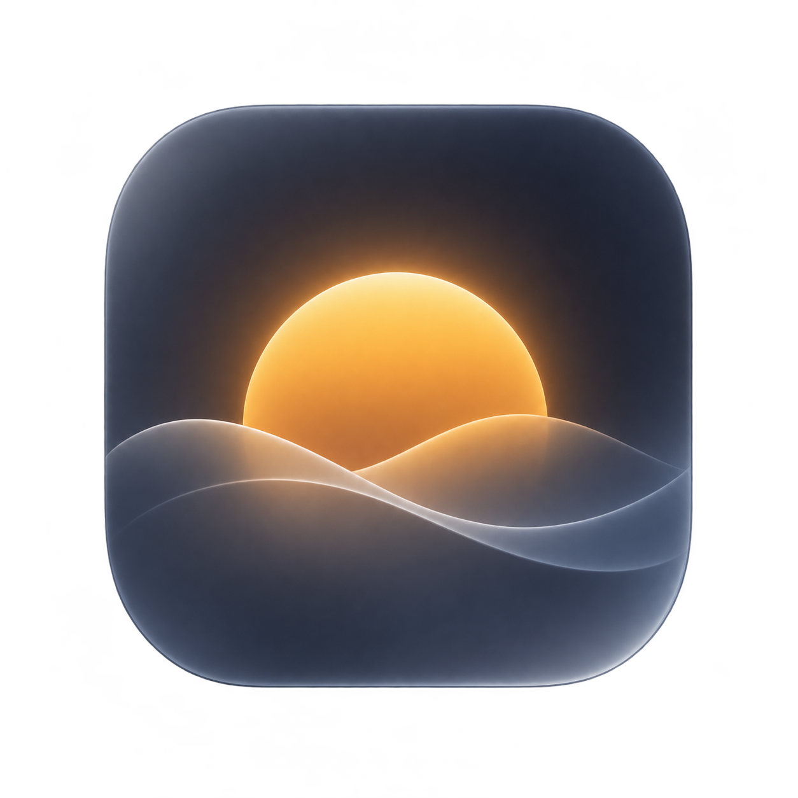
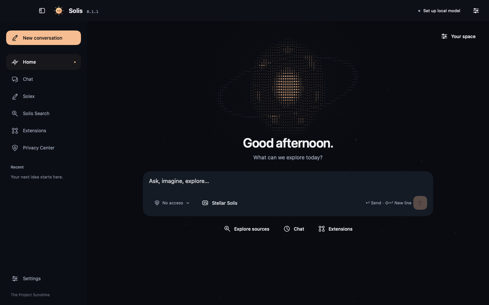

<h1>Solis</h1>

Uno spazio personale per parlare, creare e dare forma alle idee sul tuo Mac.

Un progetto di <a href="https://theprojectsunshine.com/solis">The Project Sunshine</a>.

**La 0.1.1 è stata ritirata dal download pubblico. La 0.1.2 è in preparazione e non è ancora disponibile.**

La nuova versione includerà Qwen3 1.7B e il motore locale nel DMG: nessuna installazione separata di Ollama e nessun download del modello dopo l’installazione. Verrà pubblicata dopo le verifiche e la notarizzazione.

Solis è un’app nativa per macOS con chat locale e Solex per creare file di progetto con approvazione di ogni azione. La 0.1.2 aggiungerà profilo personale, allegati, progetti con contesto condiviso, Chat/Solex in alto e animali ASCII autonomi.

L’immagine mostra la versione precedente; le schermate saranno aggiornate insieme alla 0.1.2.

[Materiali grafici](assets/) · [Sito ufficiale](https://theprojectsunshine.com/solis) · [Componenti di terzi](THIRD_PARTY.md)

© 2026 The Project Sunshine. Solis. Tutti i diritti riservati.
