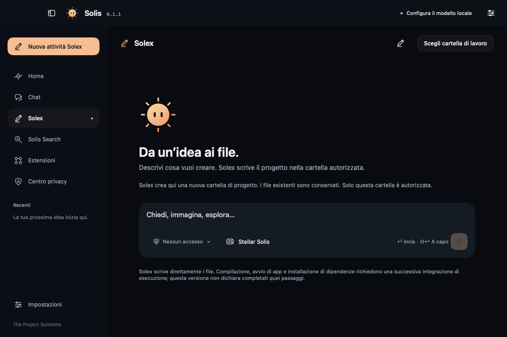
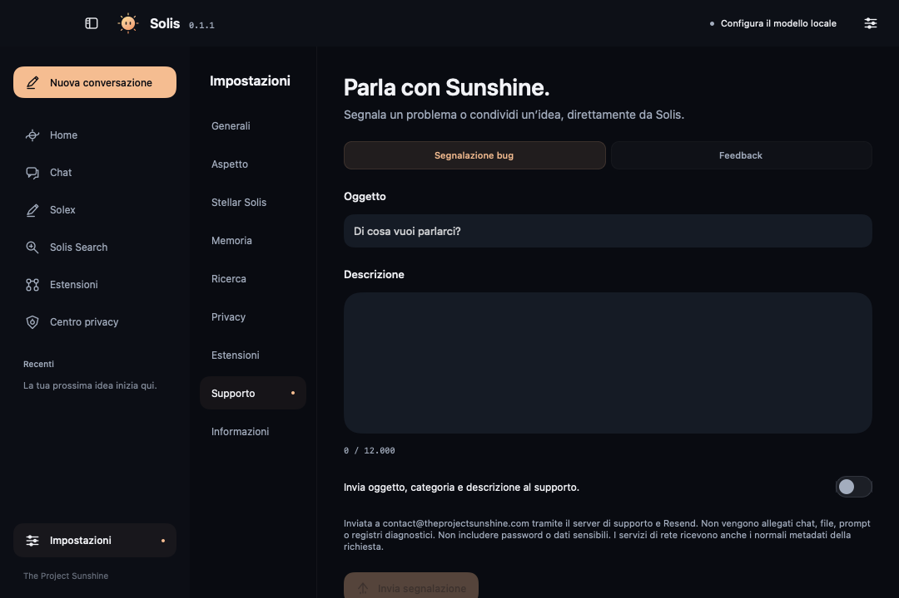

  
  <h1>Solis</h1>
  
Uno spazio personale per parlare, creare e dare forma alle idee sul tuo Mac.

  
Un progetto di <a href="https://theprojectsunshine.com/solis">The Project Sunshine</a>.

  
<a href="https://github.com/YooTommy-CH/solis/releases/download/v0.1.1/Solis-0.1.1.dmg"><strong>Scarica Solis 0.1.1 per Mac</strong></a>

  
Apple Silicon · macOS 26 o successivo · Firma Developer ID e notarizzazione Apple

## Cos’è Solis

Solis è un’applicazione nativa per macOS che unisce una chat con intelligenza artificiale locale e uno spazio per creare progetti. Nasce da The Project Sunshine con un’idea: rendere l’IA più personale, comprensibile e controllabile.

La chat usa un modello sul tuo Mac tramite Ollama. Le conversazioni rimangono nell’archivio locale dell’app; Solis non integra un servizio di inferenza cloud. Puoi esplorare l’interfaccia anche prima di configurare il modello.

## Due modi di lavorare

**Chat** è lo spazio per conversare, fare domande e sviluppare idee, con risposte in streaming e cronologia sul Mac.

**Solex** è dedicato alla creazione: descrivi un progetto, scegli la cartella di lavoro e approva le proposte. L’IA prepara l’ambiente e i file, poi Solis li scrive direttamente in una nuova cartella. Non devi copiare e incollare il codice dalla chat.

Nella 0.1.1 Solex propone progetti SwiftUI, Python o web e scrive i file approvati. Compilazione, avvio, comandi e installazione delle dipendenze non sono ancora automatici. I progetti generati richiedono verifica; la qualità dipende anche dal modello locale.

## Il tuo spazio, il tuo ritmo

Scegli fra otto animali ASCII, una scena stellare o la tua arte personale. Cambia colori, luce, dimensioni, velocità e popolazione, aggiungi il tuo nome e collegamenti preferiti. Gli animali reagiscono al puntatore; le animazioni rispettano Riduci movimento.

L’interfaccia combina controlli originali, Liquid Glass nativo e un piccolo sole con occhi e gradiente caldo.

  
  
Il segno animato dell’interfaccia.

## Ogni azione passa da te

| Permesso | Cosa consente |
| --- | --- |
| Nessun accesso | Gli strumenti di attività sul computer restano bloccati. La chat resta disponibile. |
| Accesso minimo | L’IA può proporre attività supportate che non siano ad alto rischio. |
| Accesso totale | L’IA può proporre anche attività supportate ad alto rischio, entro i permessi del sistema. |

**Sia con Accesso minimo sia con Accesso totale, ogni scelta richiede approvazione o rifiuto prima dell’esecuzione.** L’accesso totale non elimina le conferme. In Solex approvi l’ambiente e ogni file; il rifiuto interrompe la creazione del progetto. Non vengono sovrascritti automaticamente progetti esistenti.

Le Estensioni hanno una schermata iniziale di consenso revocabile. La 0.1.1 include l’estensione data e ora; il caricamento di plugin esterni e il controllo generale del computer non sono ancora attivi.

## Installazione

1. [Scarica il DMG](https://github.com/YooTommy-CH/solis/releases/download/v0.1.1/Solis-0.1.1.dmg) e trascina Solis in Applicazioni.
2. Per le risposte, installa separatamente [Ollama](https://ollama.com/download/mac) e avvialo in modalità solo locale.
3. In **Impostazioni → Stellar Solis**, configura e scarica Qwen3 1.7B con conferma.

Stellar Solis è l’identità del prodotto basata su Qwen3, non un nuovo modello addestrato. Ollama e i pesi non sono inclusi nel DMG. Gli aggiornamenti successivi vengono controllati tramite Sparkle: quando disponibili, scegli **Installa e riavvia**; alla riapertura della nuova versione trovi le novità. La 0.1 iniziale richiede questa prima installazione manuale.

[Novità della 0.1.1](https://github.com/YooTommy-CH/solis/releases/tag/v0.1.1) · [Feed aggiornamenti](appcast.xml) · [Sito ufficiale](https://theprojectsunshine.com/solis)

## Supporto e dati

Da **Impostazioni → Supporto** puoi inviare un bug o un feedback con oggetto e descrizione. Il modulo viene inoltrato direttamente a contact@theprojectsunshine.com tramite il servizio di supporto e Resend, senza aprire un programma email. Non vengono allegati automaticamente chat, file o diagnostica.

L’inferenza è locale. Download dei modelli, aggiornamenti, pagine approvate, collegamenti esterni e invio del modulo possono usare la rete. Il supporto e i relativi fornitori ricevono i normali metadati della richiesta. L’archivio locale non ha cifratura applicativa; i progetti Solex restano nella cartella scelta dall’utente.

## Materiali per il sito

Nella cartella [assets](assets/) trovi l’icona ufficiale PNG, il sole animato in GIF e SVG, un’immagine statica alternativa e le schermate della 0.1.1. [Guida all’uso sul sito](WEBSITE.md). La GIF è pensata per GitHub; l’SVG si adatta al sito e rispetta Riduci movimento.

Le schermate mostrano viste reali renderizzate fuori schermo con il fallback opaco di accessibilità: la rifrazione Liquid Glass richiede l’app aperta. Non sono fotografie del desktop. La 0.1.1 è una release Genesis: inferenza reale, qualità dei progetti e aggiornamento completo fra due release distribuite richiedono ancora verifiche dedicate.

Questo repository ospita distribuzione, aggiornamenti e materiali pubblici di Solis. I sorgenti dell’app non vengono pubblicati qui. [Componenti e licenze](THIRD_PARTY.md).

© 2026 The Project Sunshine. Solis. Tutti i diritti riservati. I componenti di terzi restano soggetti alle rispettive licenze.
