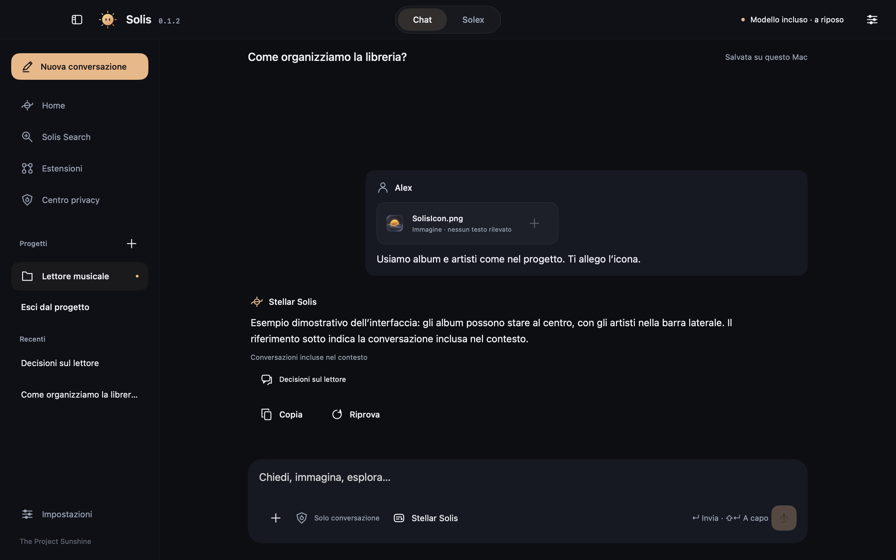
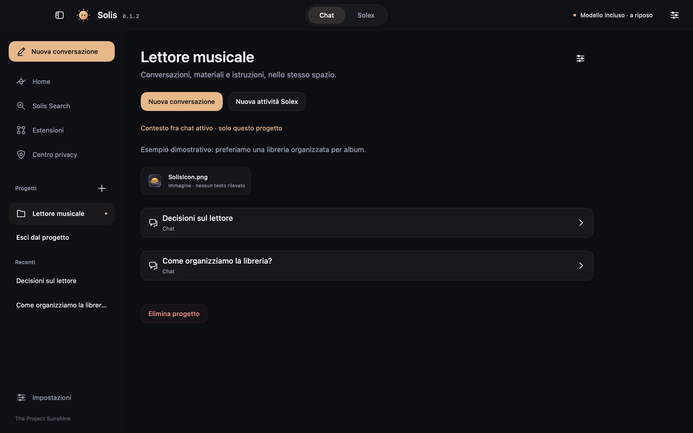
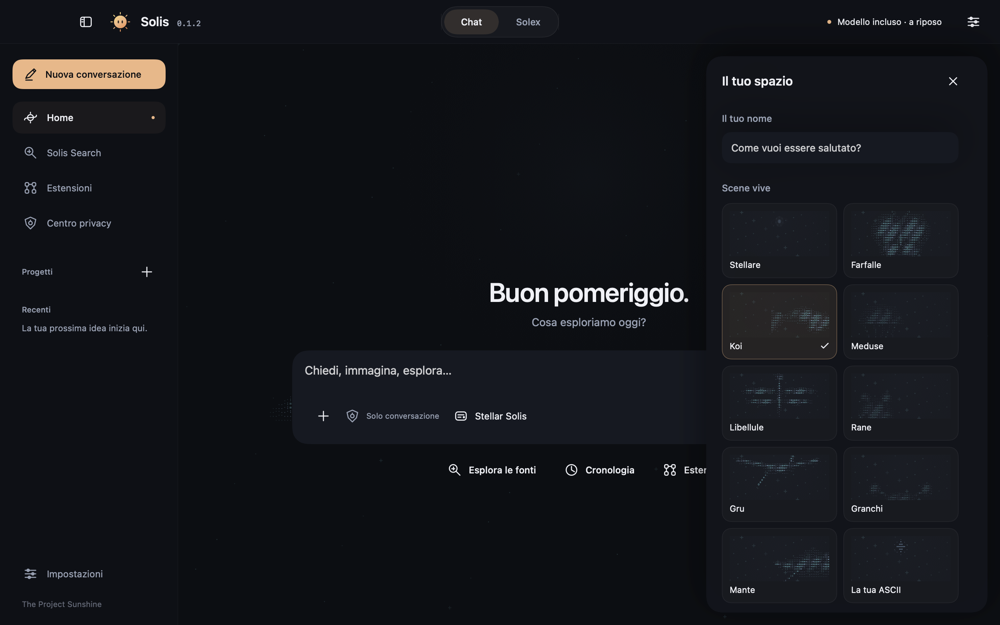

<h1>Solis</h1>

Uno spazio personale per parlare, creare e dare forma alle idee sul tuo Mac.

Un progetto di <a href="https://theprojectsunshine.com/solis">The Project Sunshine</a>.

<a href="https://github.com/YooTommy-CH/solis/releases/download/v0.1.2/Solis-0.1.2.dmg"><strong>Scarica Solis 0.1.2 · IA già inclusa</strong></a>

Apple Silicon · macOS 26+ · Firma Developer ID e notarizzazione Apple

## Installa e inizia

Scarica il DMG completo e trascina Solis in Applicazioni. **Qwen3 1.7B e il suo motore locale sono già nell’app** e vengono caricati automaticamente. Nessun programma aggiuntivo, nessun download del modello, nessun comando da copiare.

Il pacchetto è più grande perché contiene già l’IA. La generazione funziona localmente anche senza Internet. Il controllo aggiornamenti, il supporto, i collegamenti e le pagine che approvi possono usare la rete.

La 0.1.1 è stata ritirata dal download pubblico ed è sostituita dalla 0.1.2. Chi l’ha già installata può ricevere il nuovo aggiornamento tramite Sparkle.

## Due spazi, una scelta chiara

**Chat** è una conversazione: fai domande, sviluppa idee e consulta documenti. L’IA non esegue attività sul computer.

**Solex** prepara progetti e scrive direttamente i file nella cartella scelta. Approvi l’ambiente e ogni file prima che venga creato il progetto; se rifiuti, l’intera creazione viene interrotta. Il codice non rimane da copiare e incollare dalla chat.

Chat e Solex si scelgono **in alto al centro**. Il modello locale è condiviso; i permessi operativi si trovano soltanto in Solex. Nessun accesso blocca gli strumenti; Accesso minimo esclude le attività ad alto rischio; Accesso totale ammette la proposta delle attività supportate ad alto rischio. **Entrambi i livelli richiedono sempre l’approvazione di ogni scelta** e non superano le protezioni macOS.

Solex 0.1.2 propone progetti SwiftUI, Python o web e scrive nuovi file. Compilazione, avvio, comandi e installazione delle dipendenze non sono ancora automatici. I risultati generati richiedono verifica.

## Conversazioni più personali

I messaggi di Solis stanno a sinistra; i tuoi a destra, con il nome scelto. All’apertura puoi indicare come vuoi essere chiamato oppure saltare.

Da Impostazioni → Profilo puoi aggiungere nome, cognome, data di nascita con età calcolata, nazione, lavoro, informazioni e istruzioni personali. I campi sono facoltativi, modificabili ed eliminabili. L’uso del profilo nelle risposte richiede l’opzione dedicata; i dati restano sul Mac.

## Progetti che conservano il contesto

Raccogli le chat in progetti con istruzioni, memoria approvata e materiali condivisi. Solis può usare estratti pertinenti delle altre conversazioni dello stesso progetto e mostra da quali chat provengono. Puoi spostare le conversazioni fra progetti o lasciarle indipendenti.

I progetti restano separati. Il contesto ha limiti di lunghezza e non equivale a memoria illimitata dell’intera cronologia. Le memorie permanenti vengono inserite e approvate dall’utente, non create silenziosamente.

## Mostra ciò che intendi

Aggiungi immagini e file con “+”, trascinali nel compositore o incolla un’immagine dagli appunti. Vedi anteprima e stato di lettura prima dell’invio. Fino a **8 allegati per messaggio, 25 MB ciascuno**.

Sono supportati testo, codice, CSV/TSV, PDF con testo, DOCX, primo foglio XLSX e immagini comuni. Puoi condividere esplicitamente un allegato con il progetto. Le copie e le estrazioni restano locali.

**Il modello incluso è testuale:** per le immagini Solis riconosce il testo tramite OCR, senza interpretare visivamente fotografie o grafici. I PDF scansionati senza testo vengono segnalati. I documenti non vengono eseguiti; il contesto usa estratti entro i limiti del modello.

## Un ambiente che si muove da sé

Otto specie ASCII nuotano, volano o si spostano autonomamente. Non inseguono più il puntatore. Scegli anche la scena stellare o la tua arte personale, e modifica palette, luce, dimensioni, velocità e popolazione.

L’anello Sunshine segue il cursore e si espande sui controlli attivi. È disattivabile, si nasconde nei campi di testo e rispetta Riduci movimento. L’interfaccia usa Liquid Glass nativo, controlli originali e il piccolo sole animato.

## Supporto e aggiornamenti

Invia un bug o un feedback da Impostazioni → Supporto: oggetto, tipo e descrizione arrivano a contact@theprojectsunshine.com tramite il servizio dedicato e Resend, senza aprire un programma email. Nessuna chat, file o diagnostica viene allegata automaticamente.

Sparkle controlla gli aggiornamenti all’avvio quando abilitato. Quando ne trovi uno scegli **Installa e riavvia**; dopo l’installazione effettiva della nuova versione compare il riepilogo delle novità. Feed e archivio sono firmati. Il DMG completo contiene il modello anche negli aggiornamenti distribuiti con questo archivio.

[Novità della 0.1.2](https://github.com/YooTommy-CH/solis/releases/tag/v0.1.2) · [Feed aggiornamenti](https://raw.githubusercontent.com/YooTommy-CH/solis/main/appcast.xml) · [Sito ufficiale](https://theprojectsunshine.com/solis)

## Materiali per il sito

[assets/](assets/) contiene icona ufficiale, sole animato GIF/SVG, alternativa statica e schermate aggiornate. `index.html` è una pagina pronta da adattare e caricare; [WEBSITE.md](WEBSITE.md) spiega come usarla. Il sito dell’utente non viene modificato automaticamente.

Le schermate sono render fuori schermo con il fallback opaco di accessibilità. Chat e progetti mostrati sono esempi dimostrativi; la rifrazione del glass e l’interazione del cursore richiedono l’app aperta. Il motore incluso è stato verificato con generazione Chat e piano Solex reali; ciò non garantisce la qualità di qualunque risultato. Non sono dichiarati benchmark di prestazioni o batteria.

L’archivio locale non ha cifratura applicativa. Questo repository ospita distribuzione, aggiornamenti e materiali pubblici; i sorgenti dell’app restano privati. Stellar Solis è l’identità del prodotto basata su Qwen3, non un nuovo modello addestrato. [Componenti e licenze](THIRD_PARTY.md).

© 2026 The Project Sunshine. Solis. Tutti i diritti riservati. I componenti di terzi conservano le rispettive licenze.
